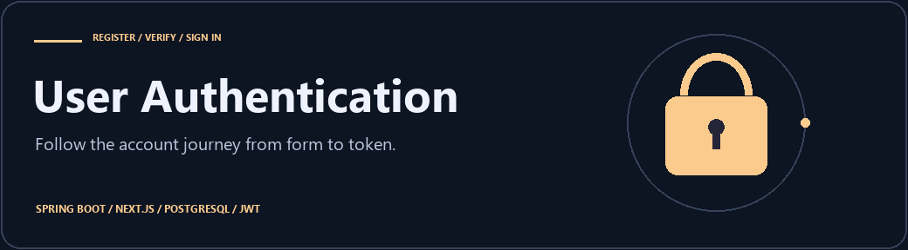

<div align="center">



# User Authentication

**Follow the account journey from form to token.**


[Overview](#overview) &nbsp; · &nbsp; [Run locally](#run-locally) &nbsp; · &nbsp; [Explore the repository](https://github.com/mcampo0215/UserAuthentication)

</div>

---

## Overview

A full-stack authentication project with registration, email verification, login, and JWT generation. Spring Boot handles account data and verification mail; a Next.js frontend provides the registration, login, and verification screens.

| Register | Verify | Sign in |
| :--- | :--- | :--- |
| Create an account backed by PostgreSQL. | Follow an emailed verification link or request another message. | Submit credentials and receive a JWT from the backend. |

## Architecture

| Layer | Implementation |
| :--- | :--- |
| Frontend | Next.js / React screens in `frontend/`. |
| API | Spring Boot 3.5, Spring Security, JPA, and mail in `backend/`. |
| Persistence | PostgreSQL user records. |
| Passwords and tokens | BCrypt password encoding and JJWT token generation. |

## Run locally

Install **JDK 21**, Node.js/npm, PostgreSQL, and access to an SMTP account.

Configure the database, JWT secret/expiry, and mail settings using [application.sample.properties](backend/src/main/resources/application.sample.properties). Keep real passwords and signing secrets in environment variables or local configuration outside commits. The sample's first line is descriptive; use a valid `spring.application.name` property for the app name.

Start the backend from `backend/`:

```powershell
.\gradlew.bat bootRun
```

On macOS/Linux, use `./gradlew bootRun`.

Start the frontend in another terminal:

```sh
cd frontend
npm ci
npm run dev
```

The frontend calls `http://localhost:8080`. The authentication controller declares `http://localhost:3002` as its allowed origin; run the frontend on that port (`npm run dev -- -p 3002`) or align the controller and security CORS settings with your chosen origin.

## API flow

| Endpoint | Purpose |
| :--- | :--- |
| `POST /api/auth/register` | Register an account and initiate verification. |
| `GET /api/auth/verify?token=...` | Verify an email token. |
| `POST /api/auth/resend-verification` | Resend a verification link. |
| `GET /api/auth/is-verified?email=...` | Check verification status. |
| `POST /api/auth/login` | Validate credentials and return a token or failure response. |

## Explore the code

- [AuthController](backend/src/main/java/com/campoverde/AuthFeatures/controller/AuthController.java)
- [UserService](backend/src/main/java/com/campoverde/AuthFeatures/service/UserService.java)
- [SecurityConfig](backend/src/main/java/com/campoverde/AuthFeatures/security/SecurityConfig.java)
- [JwtUtil](backend/src/main/java/com/campoverde/AuthFeatures/security/JwtUtil.java)
- [Frontend pages](frontend/src/app/)

JWT issuance alone does not establish a complete authenticated-resource flow. The current security configuration permits the auth routes and requires authentication elsewhere, but does not configure a JWT bearer-token filter. Additional protected-resource integration is needed for that use case.

---

<p align="center"><a href="#user-authentication">Back to the top</a></p>
